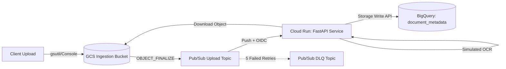

# Implementation Plan: Serverless Event-Driven Document Processing Pipeline

This document outlines the phased deployment, validation, and rollout strategy for the Google Cloud serverless document processing architecture.

---

## 1. Architecture Overview



---

## 2. Prerequisites & Pre-flight Checklist

- [ ] **GCP Project & Permissions**: Active GCP project with `Owner` or `Editor` + `Security Admin` (for IAM role assignment).
- [ ] **Google Cloud CLI (`gcloud`)**: Authenticated (`gcloud auth login`) and default project configured:
  ```bash
  gcloud config set project <YOUR_PROJECT_ID>
  ```
- [ ] **Terraform (v1.5+)**: Installed and verified on PATH.
- [ ] **GCP Service APIs Enabled**:
  ```bash
  gcloud services enable \
    run.googleapis.com \
    pubsub.googleapis.com \
    storage.googleapis.com \
    bigquery.googleapis.com \
    bigquerystorage.googleapis.com \
    artifactregistry.googleapis.com \
    cloudbuild.googleapis.com
  ```

---

## 3. Phased Implementation Roadmap

### Phase 1: Local Setup & Service Verification
- **Goal**: Validate application logic, OCR processing, and unit tests locally before cloud deployment.
- **Steps**:
  1. Create a Python virtual environment:
     ```bash
     python -m venv .venv
     .venv\Scripts\activate  # Windows pwsh: .venv\Scripts\Activate.ps1
     pip install -r requirements.txt
     ```
  2. Run unit tests:
     ```bash
     pytest tests/
     ```
  3. Run the FastAPI development server:
     ```bash
     uvicorn app.main:app --port 8080 --reload
     ```
  4. Perform health check: `curl http://localhost:8080/`

---

### Phase 2: Container Image Build & Artifact Registry
- **Goal**: Package the FastAPI processor into a container image and push it to Google Cloud Artifact Registry.
- **Steps**:
  1. Set environment variables:
     ```bash
     export PROJECT_ID="<YOUR_PROJECT_ID>"
     export REGION="us-central1"
     export REPO_NAME="doc-pipeline"
     export IMAGE_TAG="us-central1-docker.pkg.dev/${PROJECT_ID}/${REPO_NAME}/processor:v1.0.0"
     ```
  2. Create the Artifact Registry Docker repository:
     ```bash
     gcloud artifacts repositories create ${REPO_NAME} \
         --repository-format=docker \
         --location=${REGION} \
         --description="Docker repository for document processing pipeline"
     ```
  3. Submit container build via Google Cloud Build (no local Docker daemon required):
     ```bash
     gcloud builds submit --tag ${IMAGE_TAG} .
     ```

---

### Phase 3: Infrastructure Provisioning with Terraform
- **Goal**: Create all Google Cloud resources with least-privilege IAM and secure bindings.
- **Steps**:
  1. Navigate to the terraform directory:
     ```bash
     cd terraform
     ```
  2. Initialize Terraform providers:
     ```bash
     terraform init
     ```
  3. Create an execution plan:
     ```bash
     terraform plan \
       -var="project_id=${PROJECT_ID}" \
       -var="region=${REGION}" \
       -var="container_image=${IMAGE_TAG}" \
       -out=tfplan
     ```
  4. Review plan: Verify creation of:
     - 1 GCS Bucket (`doc-ingest-<random>`)
     - 2 Pub/Sub Topics (`document-upload-events`, `document-processing-dlq`)
     - 1 Pub/Sub Push Subscription (with OIDC token & dead-letter policy)
     - 1 BigQuery Dataset & Table (`document_processing.document_metadata`)
     - 2 Service Accounts (`document-processor-sa`, `pubsub-cloud-run-invoker`)
     - 1 Cloud Run v2 Service (`document-processor`)
  5. Apply configuration:
     ```bash
     terraform apply tfplan
     ```

---

### Phase 4: End-to-End Testing & Verification
- **Goal**: Confirm live event trigger, file download, OCR parsing, and BigQuery ingestion.
- **Steps**:
  1. Capture outputs:
     ```bash
     BUCKET_NAME=$(terraform output -raw storage_bucket_name)
     SERVICE_URL=$(terraform output -raw cloud_run_service_url)
     ```
  2. Create test files:
     ```bash
     echo "Contract agreement between Alpha Corp and Beta Ltd regarding cloud migration and security compliance." > sample_agreement.txt
     ```
  3. Upload the test file to GCS:
     ```bash
     gcloud storage cp sample_agreement.txt gs://${BUCKET_NAME}/sample_agreement.txt
     ```
  4. Inspect Cloud Run service logs:
     ```bash
     gcloud logging read 'resource.type="cloud_run_revision" AND resource.labels.service_name="document-processor"' --limit=15 --format="value(textPayload)"
     ```
  5. Query BigQuery for inserted metadata:
     ```bash
     bq query --use_legacy_sql=false \
       "SELECT filename, word_count, tags, status, processed_time FROM \`${PROJECT_ID}.document_processing.document_metadata\` ORDER BY processed_time DESC LIMIT 5"
     ```

---

### Phase 5: Resilience, DLQ & Error Scenarios
- **Goal**: Validate error handling and poison-pill routing.
- **Scenarios**:
  - **Deleted File Simulation**: Trigger an event for a non-existent file; verify it skips gracefully with a 200 return to avoid infinite retries.
  - **Dead Letter Queue Routing**: Verify that persistent 5xx errors trigger retry backoff and route to `document-processing-dlq` after 5 failed attempts.
  - **DLQ Monitoring**: Inspect messages on the DLQ topic using a temporary pull subscription.

---

## 4. Operational Monitoring & Observability

- **Cloud Run Metrics**: Monitor request latency (p95/p99), container CPU/memory utilization, and concurrent requests.
- **Pub/Sub Metrics**:
  - `pubsub.googleapis.com/subscription/num_undelivered_messages` (backlog indicator)
  - `pubsub.googleapis.com/subscription/dead_letter_message_count`
- **BigQuery Storage Write API**: Monitor stream append errors and throughput via Cloud Monitoring metrics.

---

## 5. Rollback & Teardown Strategy

- **Service Rollback**: Cloud Run revisions allow instant traffic rollback to a previous container version:
  ```bash
  gcloud run services update-traffic document-processor --to-revisions=PREVIOUS_REVISION=100 --region=${REGION}
  ```
- **Infrastructure Teardown**: To clean up all deployed cloud resources when testing is finished:
  ```bash
  cd terraform
  terraform destroy -var="project_id=${PROJECT_ID}" -var="region=${REGION}" -var="container_image=${IMAGE_TAG}"
  ```
