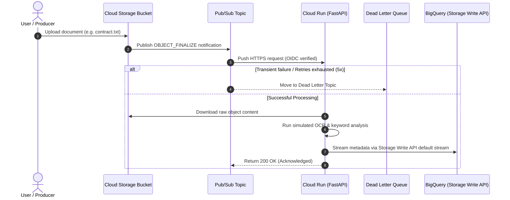

# Walkthrough: Serverless Event-Driven Document Processing Pipeline

This guide provides a comprehensive walkthrough of the document processing pipeline on Google Cloud, detailing how every component interacts, how the codebase is organized, and how to deploy and test the system end-to-end.

---

## 1. High-Level Architecture Flow



---

## 2. Codebase Tour & Component Breakdown

### 2.1 Fast Webhook Receiver: [`app/main.py`](file:///d:/playground/agy2-projects/google-cloud-severless-app/app/main.py)
- **Role**: Serves the `/pubsub/process` endpoint invoked by Pub/Sub Push subscriptions.
- **Key Logic**:
  - Validates and unmarshals the incoming JSON payload into typed models.
  - Checks message attributes (`eventType == OBJECT_FINALIZE`). Ignores unrelated operations like object deletions (`200 OK` return to acknowledge).
  - Handles missing or deleted files gracefully: returns `200 OK` with `status: skipped` to prevent infinite Pub/Sub retry loops.
  - Triggers the simulated OCR engine and dispatches structured records to BigQuery.

### 2.2 Simulated OCR Engine: [`app/services/ocr_service.py`](file:///d:/playground/agy2-projects/google-cloud-severless-app/app/services/ocr_service.py)
- **Role**: Text and binary analysis.
- **Key Logic**:
  - For text files (`.txt`, `.md`, `.json`, etc.), decodes byte streams, strips standard English stop-words, calculates word counts, and extracts top 5 keyword tags via frequency distributions (`collections.Counter`).
  - For non-text/binary files, safely falls back to synthetic token extraction without throwing decoding errors.

### 2.3 GCP Integration Layer: [`app/services/gcp_service.py`](file:///d:/playground/agy2-projects/google-cloud-severless-app/app/services/gcp_service.py)
- **Role**: Cloud Storage downloads and BigQuery ingestion.
- **Key Logic**:
  - Uses `google.cloud.storage.Client` to download uploaded files directly in-memory.
  - Connects to the **BigQuery Storage Write API** (`google.cloud.bigquery_storage_v1.BigQueryWriteClient`) targeting the table's `_default` stream.
  - Employs the compiled Protocol Buffer schema ([`app/proto/document_metadata_pb2.py`](file:///d:/playground/agy2-projects/google-cloud-severless-app/app/proto/document_metadata_pb2.py)) for high-throughput, strongly-typed row serialization.
  - Detects local/test environments (`ENVIRONMENT=test`) to bypass cloud write APIs during automated testing.

### 2.4 Infrastructure as Code: [`terraform/main.tf`](file:///d:/playground/agy2-projects/google-cloud-severless-app/terraform/main.tf)
- **GCS & Notifications**: Generates a uniquely named ingestion bucket and wires up `google_storage_notification` to publish directly into Pub/Sub.
- **Pub/Sub & DLQ**: Configures `document-upload-events` with a companion `document-processing-dlq` topic. The push subscription enforces a minimum backoff of 10s and routes messages to the DLQ after 5 consecutive failures.
- **Security & IAM**:
  - `pubsub-cloud-run-invoker` Service Account with `roles/run.invoker`.
  - `document-processor-sa` Service Account with `roles/storage.objectViewer` and BigQuery writing permissions.
  - Authenticated push subscription supplying an OIDC token matching the Cloud Run audience.
- **BigQuery**: Creates `document_processing.document_metadata` with a typed schema containing repeated strings for tags and timestamps.

---

## 3. Step-by-Step Hands-On Walkthrough

### Step 1: Local Setup & Testing
To run the service and test suite locally:

```powershell
# 1. Create and activate a Python virtual environment
python -m venv .venv
.venv\Scripts\Activate.ps1

# 2. Install dependencies
pip install -r requirements.txt

# 3. Run unit tests
pytest tests/ -v
```

> [!TIP]
> The unit tests in [`tests/test_main.py`](file:///d:/playground/agy2-projects/google-cloud-severless-app/tests/test_main.py) simulate Pub/Sub payloads, GCS file downloads, and BigQuery writes without requiring live GCP credentials.

---

### Step 2: Build and Containerize
Build the container image using Google Cloud Build and publish it to Artifact Registry:

```bash
PROJECT_ID="your-gcp-project-id"
REGION="us-central1"

# 1. Create the Artifact Registry repository
gcloud artifacts repositories create doc-pipeline \
    --repository-format=docker \
    --location=${REGION}

# 2. Build and push container
gcloud builds submit --tag ${REGION}-docker.pkg.dev/${PROJECT_ID}/doc-pipeline/processor:latest .
```

---

### Step 3: Provision Infrastructure with Terraform

```bash
cd terraform

# 1. Initialize Terraform
terraform init

# 2. Review and apply infrastructure
terraform apply \
  -var="project_id=${PROJECT_ID}" \
  -var="region=${REGION}" \
  -var="container_image=${REGION}-docker.pkg.dev/${PROJECT_ID}/doc-pipeline/processor:latest"
```

Once provisioning finishes, Terraform outputs the generated resource names:
```
Outputs:
bigquery_table        = "your-project.document_processing.document_metadata"
cloud_run_service_url = "https://document-processor-xxxx-uc.a.run.app"
pubsub_dlq_topic_name = "document-processing-dlq"
pubsub_topic_name     = "document-upload-events"
storage_bucket_name   = "doc-ingest-a1b2c3d4"
```

---

### Step 4: End-to-End Verification

1. **Upload a sample document to GCS**:
   ```bash
   BUCKET_NAME=$(terraform output -raw storage_bucket_name)

   echo "Artificial Intelligence and Machine Learning in cloud computing pipelines" > test_article.txt
   gcloud storage cp test_article.txt gs://${BUCKET_NAME}/test_article.txt
   ```

2. **Check Cloud Run processing logs**:
   ```bash
   gcloud logging read 'resource.type="cloud_run_revision" AND resource.labels.service_name="document-processor"' \
       --limit=10 \
       --format="table(timestamp, textPayload)"
   ```

3. **Verify metadata in BigQuery**:
   ```bash
   bq query --use_legacy_sql=false \
     "SELECT filename, word_count, tags, status, processed_time \
      FROM \`${PROJECT_ID}.document_processing.document_metadata\` \
      WHERE filename = 'test_article.txt'"
   ```

---

## 4. Error Handling & Dead Letter Queue (DLQ)

If a corrupt payload or unhandled runtime failure occurs:
1. Cloud Run responds with an HTTP `500` status code.
2. Pub/Sub recognizes the failure and initiates exponential backoff retries (from 10 seconds up to 600 seconds).
3. If the message fails 5 consecutive delivery attempts, Pub/Sub forwards it to `document-processing-dlq`.
4. You can inspect undeliverable messages in the DLQ via `gcloud`:
   ```bash
   gcloud pubsub subscriptions create dlq-viewer --topic=document-processing-dlq
   gcloud pubsub subscriptions pull dlq-viewer --auto-ack --limit=5
   ```

---

## 5. Teardown Instructions

To avoid recurring Google Cloud costs when you are finished testing:

```bash
cd terraform
terraform destroy \
  -var="project_id=${PROJECT_ID}" \
  -var="region=${REGION}" \
  -var="container_image=${REGION}-docker.pkg.dev/${PROJECT_ID}/doc-pipeline/processor:latest"
```
